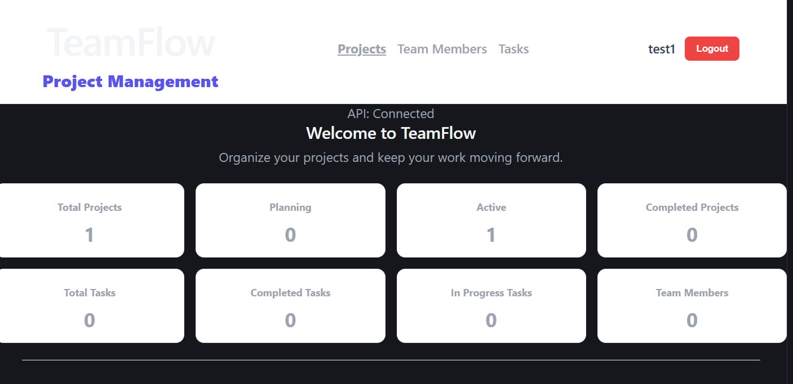
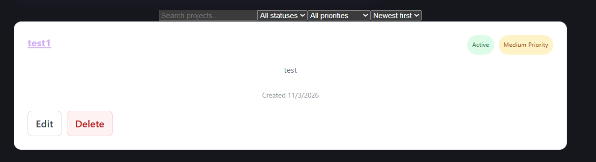
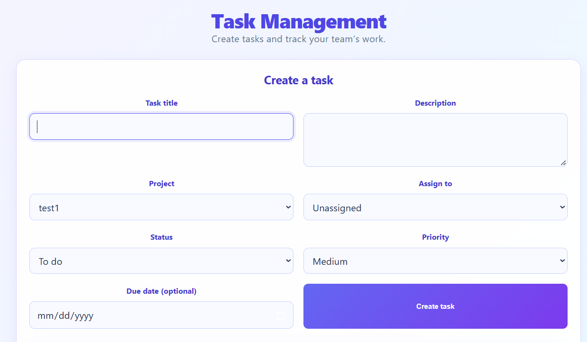
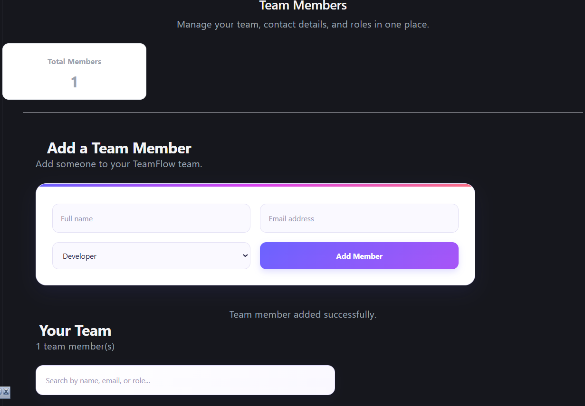

# TeamFlow – Team & Project Management Platform

A full-stack team and project management application built with React, TypeScript, Node.js, Express, and MongoDB.

TeamFlow helps users manage projects, organize tasks, assign responsibilities, and coordinate team members through a clean and responsive web interface.

## Live Demo

**Live Application:** https://teamflow-web-two.vercel.app/

**GitHub Repository:** https://github.com/jenojan24/teamflow

## Features

- **Authentication:** User registration, login, logout, and protected routes using JWT and HTTP-only cookies.
- **Project Management:** Create, view, update, and delete projects.
- **Task Management:** Create and manage tasks, update task statuses, priorities, and assignments.
- **Team Management:** Add, view, update, and remove team members.
- **Dashboard:** Overview of projects and task statistics.
- **Search and Filtering:** Search projects and filter by status and priority.
- **Sorting and Pagination:** Organize project listings.
- **Input Validation:** Request validation using Zod.
- **Automated Testing:** API and integration tests.
- **Continuous Integration:** GitHub Actions workflow for automated checks.


## Technology Stack

| Area | Technologies |
|---|---|
| Frontend | React, TypeScript, Vite |
| Backend | Node.js, Express.js, TypeScript |
| Database | MongoDB Atlas |
| Validation | Zod |
| Authentication | JWT, bcrypt, HTTP-only cookies |
| Testing | Vitest, Supertest |
| CI/CD | GitHub Actions |
| Deployment | Vercel |
| Version Control | Git, GitHub |

## Project Structure

```text
teamflow/
├── apps/
│   ├── api/
│   │   └── src/
│   │       ├── config/
│   │       ├── controllers/
│   │       ├── middleware/
│   │       ├── models/
│   │       ├── routes/
│   │       ├── services/
│   │       └── tests/
│   │
│   └── web/
│       └── src/
│           ├── components/
│           ├── context/
│           ├── lib/
│           └── pages/
│
├── package.json
└── vercel.json
```

## Getting Started

### Prerequisites

- Node.js
- npm
- MongoDB Atlas account or a local MongoDB instance
- Git

### 1. Clone the repository

```bash
git clone https://github.com/jenojan24/teamflow.git
cd teamflow
```

### 2. Install dependencies

```bash
npm install
```

### 3. Configure environment variables

Create an `.env` file inside `apps/api/`.

```env
PORT=5000
NODE_ENV=development
MONGODB_URI=your_mongodb_connection_string
MONGODB_DATABASE=teamflow
JWT_SECRET=your_jwt_secret
CLIENT_URL=http://localhost:5173
```

Never commit real environment variables or secrets to GitHub.

### 4. Start the application

Run the frontend and backend using the development scripts configured in the respective workspaces.

The frontend uses Vite and the backend runs on Express.

### 5. Run tests

```bash
npm test --workspace=apps/api
```

## Development Goals

- Continue improving application security.
- Expand automated test coverage.
- Improve user experience and responsive design.
- Develop additional collaboration features.
- Improve deployment and CI/CD workflows.

## Screenshots

### Dashboard


### Projects


### Task Management


### Team Members



## Author

**Jenojan**

Software Engineer | Full-Stack Developer

- GitHub: https://github.com/jenojan24
- LinkedIn: https://www.linkedin.com/in/jenojan-patkunanathan-235231216

---

Built as a hands-on full-stack software engineering project to practise modern development workflows and application architecture.